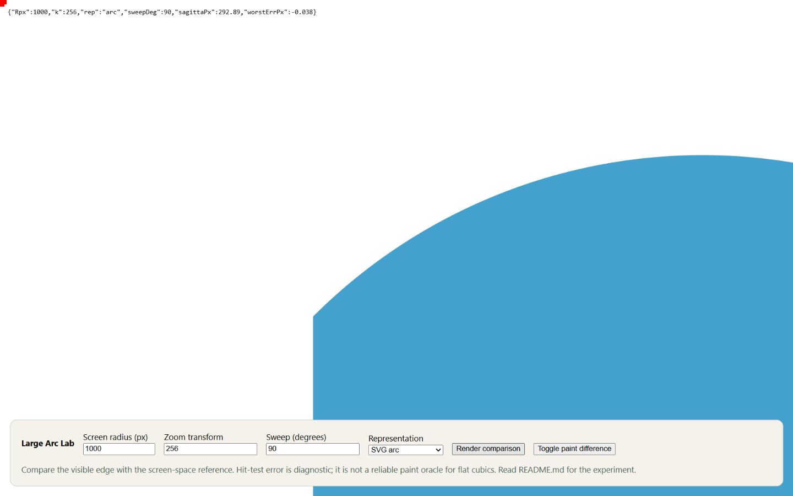

# bound.less Large Arc Lab

## Public demo

[Open the live demo](https://kobin-ai-portfolio.kobinkempe.chatgpt.site/boundless-large-arc-lab/) · [Read the case study](https://kobin-ai-portfolio.kobinkempe.chatgpt.site/case-studies/boundless-large-arc-lab/)

Compare SVG arcs and cubic approximations when an infinite canvas sends enormous coordinates through a browser's rendering pipeline.



## Try it

```sh
python -m http.server 8000 --bind 127.0.0.1
```

Open http://127.0.0.1:8000. Change screen radius, transform scale, sweep and representation, then choose **Render comparison**. **Toggle paint difference** overlays a screen-space reference. The original console-oriented experiment now has ordinary form controls; its geometry and diagnostic functions are retained.

## What it investigates

The same conceptual edge can be represented as a native SVG arc, split arcs, quarter-turn cubics, a fixed 22-degree switching rule, or the renderer's adaptive plan. At extreme scales, floating-point conversion and approximation error can become visible. A representation that looks safe in ordinary coordinates may fail when its endpoints are far outside the viewport.

The original investigation used this page to study radius-related precision and the sixth-order relationship governing cubic approximation error. Those observations motivated renderer changes; this snapshot is a reproducible experiment, not a benchmark report with fresh cross-browser measurements.

## Reading the result

Hit testing is a diagnostic, not a trustworthy paint oracle for flat cubics. The paint-difference overlay compares the visible browser edge with a sampled screen-space reference; a colored sliver makes disagreement easier to inspect. The small bars provide pixel-scale reference marks. Record browser version, viewport, zoom, device pixel ratio and chosen parameters before comparing runs.

JavaScript syntax, local dependencies, and the render/overlay controls are verified. There is no live model call. This is evidence of AI-assisted engineering, controlled experimentation and numerical debugging behind [bound.less](https://github.com/kobinkempe/bound.less-kk). [Publication review](PUBLICATION_REVIEW.md).
